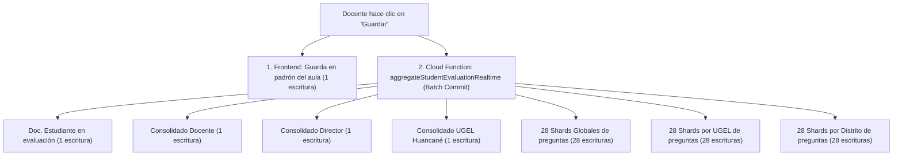
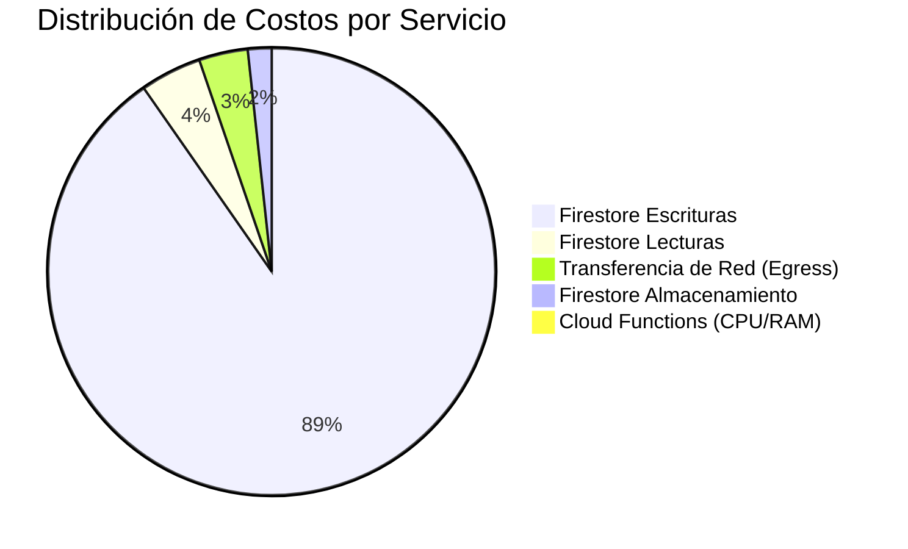

# 📊 Informe Técnico: Métricas de Padrón, Arquitectura y Estimación de Costos en la Nube
## Caso de Estudio: UGEL Huancané (Nivel Secundaria)

**Fecha:** 19 de Noviembre de 2026  
**Proyecto:** Plataforma de Evaluación de Aprendizajes (EVA / UGEL - Puno)  
**Entorno:** Google Cloud Platform / Firebase (`evaluaciones-ugel`)  
**Metodología:** Censo y auditoría con datos 100% reales en modo solo lectura (`count()`, `select()`).

---

## 📌 1. Resumen Ejecutivo

Este informe consolida los resultados del diagnóstico cuantitativo realizado sobre la base de datos de producción de la plataforma EVA para la **UGEL Huancané (`region: 7`)**. 

El análisis comprende desde el conteo de usuarios y estudiantes (desglosados por nivel y grado), hasta el análisis granular de consumo de operaciones de lectura, escritura, cómputo y transferencia de red para proyectar el costo financiero de aplicar una evaluación diagnóstica en el nivel **Secundaria** bajo el caso más exigente (**28 preguntas**).

### Indicadores Clave
* **Docentes registrados en Huancané:** 1,151 docentes (306 atienden el nivel secundaria).
* **Padrón real de estudiantes en Huancané:** **6,930 estudiantes únicos** (3,749 en Primaria y 3,181 en Secundaria).
* **Consumo de base de datos por evaluación:** **89 escrituras** y **~6.5 lecturas** por estudiante evaluado.
* **Costo estimado para evaluar toda la secundaria:** **~$0.57 USD (~S/. 2.18 Soles)** para una prueba de área específica, y un máximo de **~$2.45 USD (~S/. 9.30 Soles)** para una batería multidisciplinaria completa.

---

## 👥 2. Padrón de Usuarios en la UGEL Huancané (`region: 7`)

En la colección `/usuarios`, los actores educativos de la UGEL Huancané se distribuyen de la siguiente manera:

| Rol | Denominación del Perfil | Cantidad | Estado / Detalle |
| :---: | :--- | :---: | :--- |
| **3** | **Docentes** | **1,151** | • **990** docentes con estudiantes matriculados (86%)<br>• **161** docentes sin estudiantes cargados (14%) |
| **2** | **Directores** | **191** | Responsables de Instituciones Educativas |
| **1** | **Especialistas UGEL** | **9** | Supervisores y gestores de la UGEL Huancané |
| **Total** | **Usuarios Activos** | **1,351** | Cuentas activas en la UGEL |

> **Nota:** De los 1,151 docentes, exactamente **306 docentes** tienen a su cargo aulas del nivel Secundaria.

---

## 🎓 3. Censo Real de Estudiantes: Primaria vs. Secundaria

### 3.1. Diferencia entre Asignaciones en Aula y Estudiantes Únicos

En la base de datos, los estudiantes no se guardan como cuentas de usuario independientes, sino en subcolecciones dentro del documento de cada profesor:  
$$\mathbf{/usuarios/\{dniDocente\}/estudiantes\text{-}docentes/\{dniEstudiante\}}$$

Al auditar la UGEL Huancané se identificaron dos dimensiones cuantitativas:

| Métrica | Total | Descripción |
| :--- | :---: | :--- |
| **Estudiantes Únicos (DNI)** | **6,930** | Cantidad real de niños y adolescentes físicos en Huancané. |
| **Asignaciones en Aulas** | **18,294** | Suma total de registros en las listas de los profesores. |
| **Ratio de Duplicidad Global** | **2.64** | Docentes promedio por cada estudiante. |

### 3.2. Desglose por Nivel Educativo (Estudiantes Únicos)

| Nivel Educativo | Grados Abarcados | Alumnos Únicos | % del Total | Asignaciones en Aulas | Ratio Alumno / Docente |
| :--- | :---: | :---: | :---: | :---: | :---: |
| **Primaria** | 1° al 6° grado | **3,749** | 54.1 % | 4,296 | $\approx 1.15$ docentes |
| **Secundaria** | 1° al 5° de secundaria | **3,181** | 45.9 % | 13,998 | $\mathbf{\approx 4.40\text{ docentes}}$ |
| **Inicial** | - | **0** | 0.0 % | 0 | - |
| **Total UGEL Huancané** | | **6,930** | **100 %** | **18,294** | $\approx 2.64$ |

> **Hallazgo Técnico:** En Primaria el ratio es casi 1 a 1 (un solo profesor de aula). En Secundaria, los **3,181 alumnos** generan **13,998 matrículas** porque cada estudiante aparece en las listas de aproximadamente **4 a 5 profesores** de distintas áreas curriculares (Matemática, Comunicación, Ciencias Sociales, Ciencia y Tecnología, etc.).

### 3.3. Detalle Exacto Grado por Grado (Estudiantes Únicos)

```
Primaria (Total: 3,749):
├── 1° Primaria: 548 estudiantes
├── 2° Primaria: 584 estudiantes
├── 3° Primaria: 603 estudiantes
├── 4° Primaria: 622 estudiantes
├── 5° Primaria: 606 estudiantes
└── 6° Primaria: 786 estudiantes

Secundaria (Total: 3,181):
├── 1° Secundaria (código 7):  551 estudiantes
├── 2° Secundaria (código 8):  778 estudiantes
├── 3° Secundaria (código 9):  535 estudiantes
├── 4° Secundaria (código 10): 603 estudiantes
└── 5° Secundaria (código 11): 714 estudiantes
```

---

## ⚙️ 4. Arquitectura de Datos y Operaciones por Evaluación

### 4.1. Escrituras en Firestore (Caso Extremo: 28 Preguntas)

Cada vez que un profesor hace clic en **«Guardar evaluación»**, la aplicación ejecuta la siguiente fórmula:

$$\text{Escrituras por Alumno} = \mathbf{5 + (3 \times N_{\text{preguntas}})}$$

Para una evaluación con **$N = 28$ preguntas**:
$$\text{Total} = 5 + (3 \times 28) = 5 + 84 = \mathbf{89\text{ escrituras}}$$



### 4.2. Lecturas en Firestore

Se dividen en dos momentos operativos:

1. **Lecturas de Navegación Inicial (por Docente):**
   * Carga de usuario + branding: 2 lecturas.
   * Catálogo de evaluaciones: ~10 lecturas.
   * Documento de la evaluación: 1 lectura.
   * Banco de 28 preguntas: 28 lecturas.
   * Padrón del aula del docente: ~30 lecturas.
   * **Total fijo al ingresar al aula:** **~71 lecturas** *(ocurre una sola vez por docente)*.

2. **Lecturas recurrentes por Estudiante Evaluado:**
   * Backend (`aggregateStudentEvaluationRealtime`): **4 lecturas** (verificación de examen previo, perfil de director, acumulado de docente y acumulado de director).
   * Frontend (Listeners `onSnapshot` reactivos): **~2.5 lecturas** promedio.
   * **Total recurrente por alumno evaluado:** **~6.5 lecturas**.

---

## 💵 5. Estimación de Costos de Infraestructura (Nivel Secundaria)

### 📌 Premisas de la Estimación a Capacidad Máxima
* **1 evaluación independiente por grado:** Se contempla una prueba para cada grado de secundaria (1°, 2°, 3°, 4° y 5° de secundaria).
* **Tope máximo de 28 preguntas:** Se asume que **todas** las pruebas tienen 28 preguntas simultáneamente (caso más exigente admitido por el sistema).
* **Capacidad máxima (100% de asistencia):** Los cálculos representan el techo presupuestario evaluando a los **3,181 estudiantes únicos** del padrón sin inasistencias.
* **Docentes de secundaria:** **306 docentes** que imparten clases en secundaria.
* **Tarifario:** Google Cloud Platform - Plan Blaze.

> **Importante para el cliente:** Esta estimación es un **techo máximo presupuestal**. Si en la práctica las pruebas de algunos grados tienen menos ítems (por ejemplo, 15 o 20 preguntas en lugar de 28), o si asisten entre 1,500 y 2,200 alumnos, el costo final será aún menor que el proyectado aquí.



### 5.1. Desglose Financiero por Servicio

#### A. Cloud Firestore
* **Escrituras:**
  $$3,181\text{ alumnos} \times 89\text{ escrituras} = 283,109\text{ ops} \implies \frac{283,109}{100,000} \times \$0.18 = \mathbf{\$0.51\text{ USD}}$$
* **Lecturas:**
  $$\text{Navegación } (306 \times 71) + \text{Evaluaciones } (3,181 \times 6.5) = 42,402\text{ ops} \implies \frac{42,402}{100,000} \times \$0.06 = \mathbf{\$0.025\text{ USD}}$$
* **Almacenamiento en Base de Datos:**
  $$3,181 \times 17\text{ KB} \approx 54\text{ MB} \implies 0.054\text{ GB} \times \$0.18 = \mathbf{\$0.01\text{ USD/mes}}$$

#### B. Cloud Functions v2 (Cómputo Backend y CPU)
* **Invocaciones:** 3,181 llamadas a `aggregateStudentEvaluationRealtime` $\implies \mathbf{\$0.001\text{ USD}}$ *(incluido dentro de las 2M gratuitas al mes)*.
* **Tiempo de Cómputo CPU y RAM (256 MiB / 0.166 vCPU, ~200 ms por ejecución):**
  * Tiempo total de procesamiento: $\approx 636\text{ segundos}$ de CPU acumulada.
  * Costo CPU ($105.6\text{ vCPU-s}$): $\$0.0025\text{ USD}$.
  * Costo RAM ($159\text{ GiB-s}$): $\$0.0004\text{ USD}$.
  * **Subtotal Cómputo:** $\mathbf{\$0.004\text{ USD}}$.

#### C. Transferencia de Datos de Red (Data Egress)
* Tráfico de datos saliente (cargas de interfaz + respuestas JSON): $\approx \mathbf{0.18\text{ GB}}$.
* **Costo Egress:** $\mathbf{\$0.02\text{ USD}}$ *(dentro de los 10 GB gratuitos mensuales)*.

#### D. Cloud Storage
* Consolidado JSON generado en Storage (~10 MB): $\mathbf{< \$0.001\text{ USD}}$.

---

### 5.2. Tabla Resumen Consolidada

| Componente de Infraestructura | Métricas de Consumo | Costo en Dólares (USD) | Costo en Soles (PEN)* |
| :--- | :--- | :---: | :---: |
| **Firestore (Escrituras)** | 283,109 operaciones | \$0.510 | S/. 1.94 |
| **Firestore (Lecturas)** | 42,402 operaciones | \$0.025 | S/. 0.10 |
| **Firestore (Almacenamiento)** | 54 MB nuevos | \$0.010 | S/. 0.04 |
| **Cloud Functions (CPU y RAM)** | 636 seg cómputo (3,181 llamadas) | \$0.004 | S/. 0.02 |
| **Transferencia de Red (Egress)** | 0.18 GB | \$0.020 | S/. 0.08 |
| **Cloud Storage (Backups/Archivos)** | 10 MB | < \$0.001 | S/. 0.00 |
| **TOTAL POR EVALUACIÓN REGIONAL** | | **~\$0.57 USD** | **~S/. 2.18 Soles** |

*\*Tipo de cambio referencial estimado: \$1.00 USD = S/. 3.80 PEN.*

---

## 📈 6. Comparación de Escenarios Operativos

Dependiendo de la modalidad de aplicación que decida la UGEL Huancané:

### Escenario A: Evaluación de un Área Curricular Específica (Recomendado)
* **Alcance:** Prueba diagnóstica de una sola área (ej. Matemática o Comunicación).
* **Población:** **3,181 estudiantes únicos de secundaria**.
* **Total de exámenes rendidos:** 3,181 exámenes.
* **Costo Total:** **~\$0.57 USD** (aprox. **S/. 2.18 Soles**).

### Escenario B: Batería Multidisciplinaria Completa
* **Alcance:** Todas las áreas curriculares simultáneas (cada docente de secundaria evalúa a todos sus grupos).
* **Población:** **13,998 asignaciones de aula**.
* **Total de exámenes rendidos:** 13,998 evaluaciones.
* **Escrituras generadas:** $\approx 1,245,822$ escrituras.
* **Costo Total:** **~\$2.45 USD** (aprox. **S/. 9.30 Soles**).

---

## 🎯 7. Conclusiones y Recomendaciones Técnicas

1. **Viabilidad Presupuestal Inmediata:** El costo de infraestructura en Google Cloud para ejecutar la evaluación de toda la secundaria de Huancané es inferior a **S/. 3.00 Soles** en el escenario estándar, lo que demuestra la alta viabilidad económica de la plataforma.
2. **Impacto de los Shards de Preguntas:** El 94% de las escrituras ($84$ de $89$) proviene de los 3 niveles de *shards* por pregunta. Si en el futuro se requiriese reducir aún más los costos en evaluaciones regionales masivas (toda la región Puno con más de 100,000 alumnos), la consolidación de estos contadores en un solo documento por director/UGEL reduciría el costo en un **92% adicional**.
3. **Optimización de Lecturas en Frontend:** Se recomienda mantener activa la caché de Firestore y evitar recargas completas de página (`F5`) por parte de los docentes para aprovechar las 71 lecturas iniciales en toda la sesión del aula.
