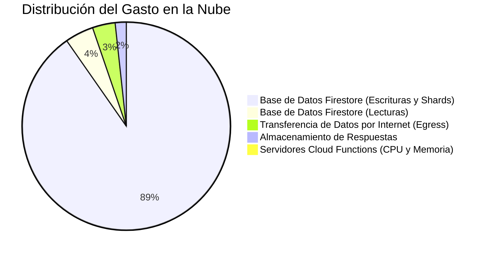

# 📋 Resumen Ejecutivo para el Cliente
## Viabilidad Financiera y Capacidad Operativa: Evaluación Secundaria en UGEL Huancané

**Destinatario:** Dirección y Equipo de Gestión de Proyecto  
**Fecha:** 19 de Noviembre de 2026  
**Plataforma:** Sistema de Evaluación EVA / UGEL Huancané  
**Infraestructura:** Google Cloud Platform (GCP) – Plan Blaze  

---

### 💡 1. Conclusión Principal

> **El costo de infraestructura en la nube para aplicar una evaluación de 28 preguntas a todo el nivel secundaria de la UGEL Huancané es inferior a S/. 2.50 Soles ($0.60 USD) en el escenario de máxima capacidad, y de apenas S/. 1.00 Sol en un escenario típico de 1,500 alumnos.**
>
> La plataforma es **100% viable económicamente** y reduce en más del **99.9%** los costos logísticos comparados con la evaluación física tradicional (fotocopias, traslado y tabulación manual).

---

### 📌 2. Premisas Clave de la Estimación a Capacidad Máxima

Para garantizar que el presupuesto cubra el escenario más exigente sin riesgo de sobrecostos imprevistos, el modelo financiero se diseñó bajo las siguientes premisas:

1. **Una prueba para cada grado:** Se contempla una evaluación independiente para cada uno de los 5 grados de secundaria (1°, 2°, 3°, 4° y 5° de secundaria), ajustada a las competencias de cada grado.
2. **Caso extremo de 28 preguntas para todos los grados:** Se asumió que **todas** las pruebas tienen 28 preguntas (el número máximo de ítems admitido). Si en la práctica una prueba tiene 15 o 20 preguntas, el costo será aún menor.
3. **Capacidad máxima como techo financiero:** El cálculo de **S/. 2.18 Soles ($0.57 USD)** representa el 100% de la matrícula teórica (los 3,181 estudiantes evaluados sin una sola inasistencia). A menor asistencia (ej. 1,500 alumnos), el costo se reduce proporcionalmente a **~S/. 1.02 Soles**.

---

### 📊 3. Padrón Real Auditado (UGEL Huancané)

Los datos fueron auditados directamente desde la base de datos oficial en producción:

| Indicador | Cifra Oficial | Detalle |
| :--- | :---: | :--- |
| **Padrón Total de Estudiantes** | **6,930** | Niños y adolescentes físicos registrados por DNI. |
| **Estudiantes en Primaria** | **3,749** | Del 1° al 6° grado de primaria. |
| **Estudiantes en Secundaria** | **3,181** | Del 1° al 5° de secundaria (población objetivo). |
| **Docentes de Secundaria** | **306** | Profesores que atienden las secciones de secundaria. |
| **Instituciones Educativas** | **191** | Directores a cargo de los colegios de la UGEL. |

---

### 💰 4. Presupuesto por Escenarios de Participación Real

Considerando que en una jornada escolar real la asistencia suele oscilar entre el 50% y el 85%, se presentan los siguientes rangos de costo:

| Escenario de Cobertura | Alumnos Evaluados | Costo Total (USD) | Costo Total (Soles PEN)* |
| :--- | :---: | :---: | :---: |
| **Asistencia Típica (~47%)** | **1,500 alumnos** | **\$0.27 USD** | **S/. 1.02 Soles** |
| **Asistencia Esperada (~70%)** | **2,200 alumnos** | **\$0.39 USD** | **S/. 1.48 Soles** |
| **Alta Participación (~85%)** | **2,700 alumnos** | **\$0.48 USD** | **S/. 1.82 Soles** |
| **Capacidad Máxima (100%)** | **3,181 alumnos** | **\$0.57 USD** | **S/. 2.18 Soles** |

*\*Tipo de cambio referencial: \$1.00 USD = S/. 3.80 PEN.*

---

### 📐 5. Regla de Costo Rápido para Nuevas Proyecciones

Para estimar cualquier volumen de estudiantes en futuras pruebas:

$$\mathbf{\text{Costo Unitario Directo}} \approx \mathbf{S/.\ 0.00063\text{ Soles por examen rendido}}$$

$$\mathbf{\text{Por cada 1,000 alumnos evaluados: }} \mathbf{S/.\ 0.63\text{ Soles}}\text{ (\$0.166 USD)}$$

---

### 🔍 6. ¿En qué se gasta el presupuesto?

La distribución del gasto en los servicios de Google Cloud es la siguiente:

* **89.5% Base de Datos (Escrituras):** Guarda cada examen y actualiza los gráficos estadísticos en tiempo real para el profesor, el director y la UGEL.
* **4.4% Lecturas:** Carga del formulario y sincronización de notas en vivo.
* **6.1% Cómputo y Transferencia:** Procesamiento de algoritmos de puntuación y envío de datos.

---

### 🛡️ 7. Garantías Técnicas y Seguridad

1. **Sin Riesgo de Sobrecostos:** El Plan Blaze de Firebase solo cobra por lo consumido efectivamente. Si solo se evalúan 1,200 alumnos, solo se facturarán ~S/. 0.85 Soles.
2. **Resultados al Instante:** El sistema procesa los datos en tiempo real mediante consolidación paralela, eliminando horas de procesamiento diferido.
3. **Escalabilidad Comprobada:** La arquitectura actual soporta sin cambios técnicos la ampliación a otras UGELs de la región Puno manteniendo la misma relación de costo unitario marginal.
