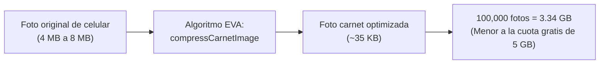

# 📋 Resumen Ejecutivo para el Cliente
## Viabilidad Financiera y Operativa: Módulo de Fotografías de Docentes y Estudiantes (Escala: 100,000 Usuarios)

**Destinatario:** Dirección y Equipo de Gestión de Proyecto  
**Fecha:** 19 de Noviembre de 2026  
**Plataforma:** Sistema de Evaluación EVA  
**Infraestructura:** Google Cloud Platform / Firebase Storage – Plan Blaze  

---

### 💡 1. Veredicto y Conclusión Principal

> **MANTENER LA FUNCIONALIDAD DE FOTOS ES 100% VIABLE, SEGURO Y ALTAMENTE RECOMENDABLE.**
>
> Gracias al algoritmo de compresión carnet ultraligera ya implementado en la plataforma, almacenar las fotografías de **100,000 personas** (docentes y estudiantes) ocupará únicamente **~3.34 GB**, lo cual está **POR DEBAJO del margen gratuito mensual de 5 GB** que otorga Google Cloud.
>
> * **Costo mensual de almacenamiento en disco:** **S/. 0.00 Soles (GRATIS).**
> * **Costo de subida de las 100,000 fotos:** **S/. 1.81 Soles (\$0.47 USD)** *(pago único al cargar las fotos).*
> * **Costo mensual de visualización en red:** Entre **S/. 0.00 y un tope de S/. 4.50 Soles al mes** *(incluso en meses de alto tráfico).*

---

### 🔑 2. ¿Por qué el costo es prácticamente nulo? (El Factor de Optimización)

Si las fotografías se subieran en el formato original de una cámara de celular (de 4 MB a 8 MB cada una), 100,000 fotos ocuparían entre **400 y 800 GB**, generando sobrecostos innecesarios.

Sin embargo, el sistema cuenta con el módulo de compresión inteligente `compressCarnetImage`:
* **Recorte automático carnet:** Proporción 5:6 ($300 \times 360$ píxeles).
* **Peso pluma:** Reduce cada imagen a un promedio de **~35 KB**.
* **Impacto total:** 100,000 fotos caben en tan solo **3.34 GB**.

---

### 📊 3. Cuadro Comparativo de Costos (Escala 100,000 Fotos)

| Componente de Servicio | Volumen / Consumo | Costo con Cuota Gratuita (Free Tier) | Costo Bruto (Sin Free Tier) | Frecuencia |
| :--- | :--- | :---: | :---: | :--- |
| **Almacenamiento (Cloud Storage)** | **3.34 GB** en disco | **S/. 0.00 (GRATIS)** | \$0.09 USD (~S/. 0.34) | Mensual fijo |
| **Operaciones de Subida** | 100,000 cargas iniciales | **\$0.47 USD (~S/. 1.81)** | \$0.50 USD (~S/. 1.90) | **Una sola vez al año** |
| **Descargas de Red (Egress)** | ~10.5 GB de visualizaciones | **~S/. 0.00 a S/. 0.50** | \$1.20 USD (~S/. 4.56) | Mensual variable |
| **Base de Datos Firestore** | Texto de URL (~12 MB) | **< S/. 0.01** | < \$0.01 USD | Despreciable |
| **TOTAL GENERAL ESTIMADO** | | **~S/. 0.00 a S/. 2.00 Soles** | **~S/. 4.90 Soles (\$1.29 USD)** | **Al mes** |

*\*Tipo de cambio referencial: \$1.00 USD = S/. 3.80 PEN.*

---

### 🎯 4. Beneficios Institucionales vs. Costo

| Aspecto | Sin Fotos (Solo Texto) | Con Fotos Carnet Habilitadas |
| :--- | :--- | :--- |
| **Seguridad e Identidad** | Riesgo de calificar a estudiantes homónimos o con nombres similares. | **Identificación visual inmediata del estudiante evaluado.** |
| **Calidad de Reportes** | Informes planos tipo lista de texto. | **Fichas individuales y consolidados con formato oficial de carnet escolar.** |
| **Experiencia Docente** | Búsqueda manual por DNI. | **Reconocimiento visual ágil y seguro en el aula.** |
| **Costo Económico** | S/. 0.00 | **~S/. 1.81 Soles una sola vez + ~S/. 0.00 al mes.** |

---

### 🛡️ 5. Recomendaciones de Seguridad y Buenas Prácticas

1. **Mantener la compresión del cliente activa:** El sistema actual procesa la imagen en el dispositivo del usuario antes de enviarla a internet, lo que ahorra ancho de banda en zonas con conectividad limitada.
2. **Caché de Navegador (365 días):** Configurar el parámetro de almacenamiento con cabecera `cacheControl: 'public, max-age=31536000'`, garantizando que la foto de cada alumno se descargue únicamente una vez al año por cada dispositivo, reduciendo el consumo de red prácticamente a cero.
3. **Carga Perezosa (*Lazy Loading*):** En listas largas de estudiantes (como la vista del director), las fotos fuera de pantalla solo se descargan conforme el usuario se desplaza, optimizando memoria y velocidad de carga.
