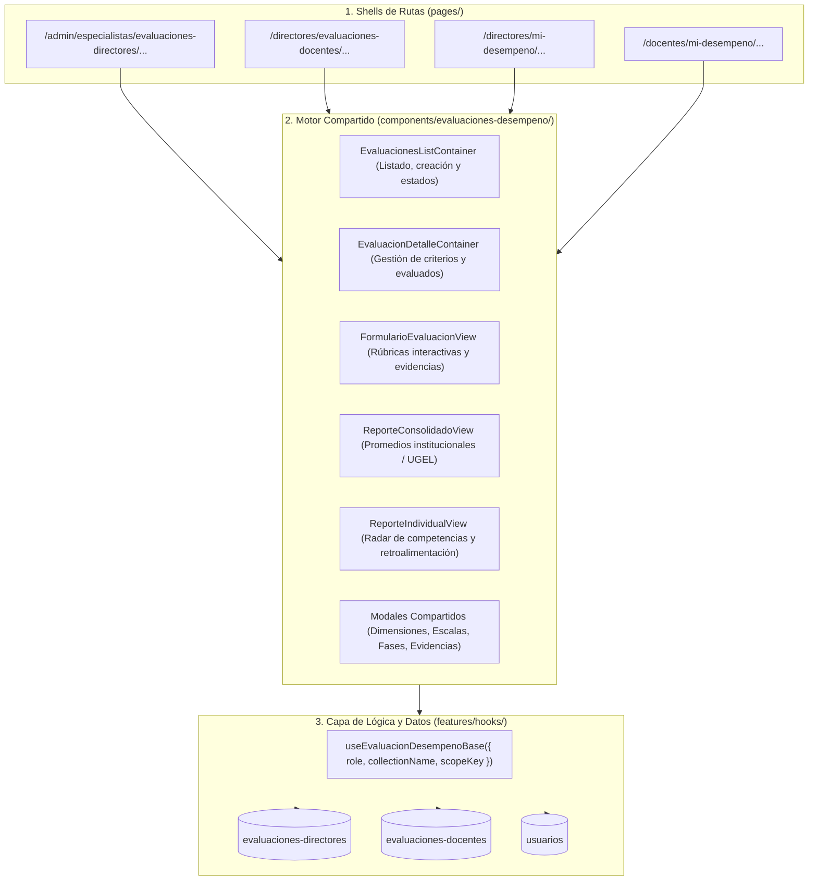

# 📋 Plan de Implementación: Sistema Jerárquico de Evaluaciones de Desempeño

Este documento describe la arquitectura técnica, estructura de rutas, modelo de datos y fases de ejecución para implementar el flujo completo de evaluación de desempeño por rúbricas y evidencias para **Especialistas**, **Directores** y **Docentes** en el portal EVA.

---

## 🎯 1. Visión y Objetivos

1. **Jerarquía Institucional**:
   - **Especialista UGEL** (`rol: 1`) → Evalúa a los **Directores** de su ámbito territorial (`region`).
   - **Director de I.E.** (`rol: 2`) → Monitorea y evalúa a los **Docentes** de su propia institución educativa (`dniDirector`).
   - **Docente** (`rol: 3`) → Consulta sus evaluaciones recibidas, niveles de logro, evidencias y retroalimentación formativa.
   - **Director como Evaluado** → Consulta la evaluación aplicada por su Especialista UGEL.
2. **Rutas Independientes con Seguridad por Rol (RBAC)**:
   - Cada rol opera en sus propias rutas protegidas por sus guards ([`PrivateRouteAdmins`](file:///home/frecodev/Documentos/eva/components/layouts/PrivateRoutesAdmins.tsx), [`PrivateRouteDirectores`](file:///home/frecodev/Documentos/eva/components/layouts/PrivateRoutesDirectores.tsx), [`PrivateRouteDocentes`](file:///home/frecodev/Documentos/eva/components/layouts/PrivateRoutesDocentes.tsx)).
3. **Cero Duplicación de Código ("Rutas Shell + Feature Engine Compartido")**:
   - Las páginas en `pages/` son contenedores delgados (*shells* de ~20 líneas).
   - Toda la lógica interactiva, modales, rúbricas y reportes se centralizan en componentes reutilizables parametrizados.

---

## 🏗️ 2. Arquitectura del Sistema



---

## 🗂️ 3. Estructura de Rutas Independientes

### 3.1. Especialistas UGEL (Ruta de Gestión UGEL)
* `pages/admin/especialistas/evaluaciones-especialistas/index.tsx` → Lista de evaluaciones dirigidas a Directores.
* `pages/admin/especialistas/evaluaciones-especialistas/evaluacion/[id].tsx` → Panel de la evaluación:
  - Padrón de Directores filtrado por: `where('rol', '==', 2), where('region', '==', currentUserData.region)`.
  - Configuración de dimensiones, escalas, fases y evidencias.
* `pages/admin/especialistas/evaluaciones-especialistas/evaluacion/evaluar/[dniDirector].tsx` → Formulario de rúbricas para evaluar al Director.
* `pages/admin/especialistas/evaluaciones-especialistas/evaluacion/reporte/index.tsx` → Reporte consolidado UGEL.
* `pages/admin/especialistas/evaluaciones-especialistas/evaluacion/reporte-individual/[dniDirector].tsx` → Reporte individual del Director.

### 3.2. Directores (Ruta como Evaluador de Docentes)
* `pages/directores/evaluaciones-docentes/index.tsx` → Lista de evaluaciones docentes institucionales.
* `pages/directores/evaluaciones-docentes/evaluacion/[id].tsx` → Panel institucional de la evaluación:
  - Padrón de Docentes de la I.E. filtrado por: `where('rol', '==', 3), where('dniDirector', '==', currentUserData.dni)`.
  - Muestra tabla con estado: *Evaluado* (🟢) o *Pendiente* (🟡).
* `pages/directores/evaluaciones-docentes/evaluacion/evaluar/[dniDocente].tsx` → Formulario de rúbricas y subida de evidencias para evaluar al Docente.
* `pages/directores/evaluaciones-docentes/evaluacion/reporte/index.tsx` → Reporte consolidado de la I.E. (promedios por competencia en su colegio).
* `pages/directores/evaluaciones-docentes/evaluacion/reporte-docente-individual/[dniDocente].tsx` → Reporte individual por profesor.

### 3.3. Directores (Ruta como Evaluado por la UGEL)
* `pages/directores/mi-desempeno/index.tsx` → Historial de evaluaciones recibidas de la UGEL.
* `pages/directores/mi-desempeno/[idEvaluacion].tsx` → Consulta de resultados: niveles por dimensión, evidencias registradas por el especialista, compromisos y descarga de reporte.

### 3.4. Docentes (Ruta de Consulta y Crecimiento Profesional)
* `pages/docentes/mi-desempeno/index.tsx` → Historial de evaluaciones/monitoreos recibidos de su Director.
* `pages/docentes/mi-desempeno/[idEvaluacion].tsx` → Consulta de su evaluación:
  - Rúbricas y niveles alcanzados.
  - Evidencias pedagógicas levantadas por el Director.
  - Retroalimentación formativa y compromisos.
  - Reporte Individual descargable.

---

## 💾 4. Modelo de Datos y Seguridad en Firestore

### 4.1. Asignación de Evaluados
| Relación | Colección Evaluados | Filtro de Búsqueda de Personal | Filtro de Seguridad |
| :--- | :--- | :--- | :--- |
| **Especialista → Director** | `/evaluaciones-especialista/{id}/evaluados` | `usuarios` donde `rol == 2 && region == currentUserData.region` | Ámbito UGEL |
| **Director → Docente** | `/evaluaciones-docentes/{id}/evaluados` | `usuarios` donde `rol == 3 && dniDirector == currentUserData.dni` | Ámbito I.E. |
| **Docente (Lectura)** | `/evaluaciones-docentes/{id}/evaluados` | Directo: `evaluadoDni == currentUserData.dni` | Su propio registro |
| **Director (Lectura UGEL)** | `/evaluaciones-especialista/{id}/evaluados` | Directo: `evaluadoDni == currentUserData.dni` | Su propio registro |

### 4.2. Estructura de Documento Evaluado
```typescript
{
  idEvaluacion: string,
  evaluadoDni: string,
  evaluadoNombre: string,
  evaluadoColegio: string,
  evaluadorDni: string,
  evaluadorNombre: string,
  dniDirector?: string,       // Presente en evaluaciones a docentes
  region?: number | string,   // Presente en evaluaciones a directores
  fechaEvaluacion: Timestamp,
  dimensiones: [...],
  respuestas: [...],
  evidencias: [...],
  compromisos?: string,
  observaciones?: string,
  puntajeTotal: number,
  nivelAlcanzado: string
}
```

---

## 🚀 5. Fases de Implementación

### Fase 1: Modularización del Feature Engine Compartido
- [x] Crear directorio `components/evaluaciones-desempeno/` para albergar los componentes reutilizables.
- [x] Generalizar modales existentes (Dimensiones, Fases, Escalas, Evidencias, Niveles por Dominio).
- [x] Crear el hook base unificado `useEvaluacionDesempenoBase.ts` que parametrice:
  - `collectionName`: `'evaluaciones-especialista'` | `'evaluaciones-docentes'`.
  - `role`: `'especialista'` | `'director'` | `'docente'`.
  - `scopeQuery`: Filtro por `region` (para directores) o `dniDirector` (para docentes).

### Fase 2: Implementación de la Ruta del Director (Evaluando a Docentes)
- [x] Refactorizar [`pages/directores/evaluaciones-docentes/index.tsx`](file:///home/frecodev/Documentos/eva/pages/directores/evaluaciones-docentes/index.tsx) conectándolo al nuevo motor.
- [x] Actualizar [`pages/directores/evaluaciones-docentes/evaluacion/[id].tsx`](file:///home/frecodev/Documentos/eva/pages/directores/evaluaciones-docentes/evaluacion/%5Bid%5D.tsx):
  - Reemplazar el input manual de DNI por la lista automática de docentes vinculados por `dniDirector === currentUserData.dni`.
  - Mostrar badge de estado (*"Evaluado"* / *"Pendiente"*).
- [x] Conectar pantalla interactiva de evaluación docente con rúbricas y evidencias ([`pages/directores/evaluaciones-docentes/evaluacion/evaluar/[dniDocente].tsx`](file:///home/frecodev/Documentos/eva/pages/directores/evaluaciones-docentes/evaluacion/evaluar/%5BdniDocente%5D.tsx)).
- [x] Conectar reportes consolidados por I.E. e individuales por docente con la colección unificada `/evaluaciones-docentes/${idEvaluacion}/evaluados`.

### Fase 3: Implementación de las Rutas de Consulta
- [x] **Directores**: Crear [`/directores/mi-desempeno/`](file:///home/frecodev/Documentos/eva/pages/directores/mi-desempeno/index.tsx) y [`/directores/mi-desempeno/[idEvaluacion].tsx`](file:///home/frecodev/Documentos/eva/pages/directores/mi-desempeno/%5BidEvaluacion%5D.tsx) para que el director consulte su evaluación y monitoreo aplicado por la UGEL.
- [x] **Docentes**: Crear [`/docentes/mi-desempeno/`](file:///home/frecodev/Documentos/eva/pages/docentes/mi-desempeno/index.tsx) y [`/docentes/mi-desempeno/[idEvaluacion].tsx`](file:///home/frecodev/Documentos/eva/pages/docentes/mi-desempeno/%5BidEvaluacion%5D.tsx) para que el docente consulte su evaluación de mediación didáctica aplicada por su director, con recomendaciones, rúbricas y evidencias.
- [x] Conectar accesos en la barra de navegación lateral ([`SidebarDirectores.tsx`](file:///home/frecodev/Documentos/eva/components/sidebar/SidebarDirectores.tsx) y [`SidebarDocentes.tsx`](file:///home/frecodev/Documentos/eva/components/sidebar/SidebarDocentes.tsx)) y configurar etiquetas en [`sidebarLabelsConfig.ts`](file:///home/frecodev/Documentos/eva/features/sidebar/sidebarLabelsConfig.ts).

### Fase 4: Optimización del Flujo de Especialistas
- [x] Conectar el filtro automático de directores por `region === currentUserData.region` en el panel de Especialistas ([`pages/admin/especialistas/evaluaciones-especialistas/`](file:///home/frecodev/Documentos/eva/pages/admin/especialistas/evaluaciones-especialistas/index.tsx) y [`pages/admin/especialistas/evaluaciones-especialistas/evaluacion/[id].tsx`](file:///home/frecodev/Documentos/eva/pages/admin/especialistas/evaluaciones-especialistas/evaluacion/%5Bid%5D.tsx)).
- [x] Permitir a los Especialistas DREP (`rol: 4` o `rol: 0`) alternar entre UGELs sin restricción mediante selector interactivo.
- [x] Pre-cargar automáticamente el director seleccionado vía query params (`idDirector` / `dniDirector`) en [`evaluar-especialista`](file:///home/frecodev/Documentos/eva/pages/admin/especialistas/evaluaciones-especialistas/evaluacion/evaluar-especialista/index.tsx).
- [x] Soporte de filtro por UGEL para directores y especialistas en lista de evaluados ([`EvaluadosTable.tsx`](file:///home/frecodev/Documentos/eva/features/evaluados-especialistas/components/EvaluadosTable.tsx)).

### Fase 5: Verificación y Pruebas
- [x] Pruebas de navegación y control de acceso con cuentas de Especialista, Director y Docente (guards `PrivateRouteDirectores`, `PrivateRouteDocentes`, `PrivateRouteAdmins` y catálogos en `sidebarLabelsConfig.ts`).
- [x] Validación de compilación TypeScript (`npx tsc --noEmit` completado con 0 errores).
- [x] Ejecución y creación de pruebas unitarias con Jest / React Testing Library (42 suites, 260 tests aprobados al 100%).
